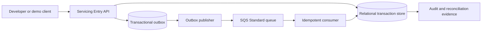

# Servicing Ledger Platform

An independent portfolio project for recording synthetic loan-servicing entries with idempotent request handling, an auditable state change, and recoverable asynchronous event processing.

> **Portfolio disclaimer:** This is a personal reference implementation. It is not a deployed financial-institution platform, does not connect to a bank or lender, and does not move money. All identifiers and amounts must be synthetic. It does not establish PCI DSS, SOC 2, SOX, or other compliance.

## Project status

| Capability | Status |
|---|---|
| Local synthetic entry API with idempotency and SQLite transaction boundary | Implemented in this repository; execution and performance results have not been recorded |
| Local outbox worker with consumer receipt deduplication | Implemented in this repository; execution results have not been recorded |
| Disposable single-replica Helm demonstration | Starter chart; not suitable for durable or production use |
| AWS EKS, RDS PostgreSQL, SQS, Terraform landing zone, GitOps, and multi-region recovery | Reference design and implementation roadmap; not deployed |
| SLOs, recovery objectives, costs, and acceptance criteria | Proposed targets or plans; not measured results |

## Business problem

Loan-servicing platforms must accept repeated requests safely, preserve a trustworthy transaction history, and recover delayed work without creating duplicate business effects. This project demonstrates those controls through a **synthetic servicing-entry workflow**. It deliberately stops before settlement, payment initiation, customer communications, or integration with a real servicing system.

The candidate profile in the source brief supports the domain choice: prior work described there includes mortgage-origination and loan-servicing infrastructure, managed-database modernization, recovery workflows, and auditable delivery. This portfolio architecture is proposed work and must not be described as professional production experience.

## What the local implementation does

1. Accepts a synthetic servicing entry over HTTP.
2. Requires an `Idempotency-Key`; a retry with the same key and same request returns the original entry, while reuse with a different payload returns `409`.
3. Writes the entry, an append-only application audit row, and an outbox event in one SQLite transaction.
4. Lets a local worker consume pending outbox rows and insert a unique consumer receipt, so replay does not create a second receipt.
5. Provides health and readiness endpoints.

The local worker shares one SQLite database and commits its receipt and local handled marker together. That is a deliberately small simulator. The AWS reference design separates the database, SQS, and consumer; the SQS delivery path is at least once, so the consumer still needs its own durable deduplication boundary. This project does **not** claim distributed exactly-once processing.

## Quick start

Requires Python 3.12 or newer. The application uses only the Python standard library.

```powershell
$env:SERVICING_DB_PATH = "$PWD\work\servicing.db"
python .\app\servicing_api.py
```

In a second terminal, run the local outbox worker:

```powershell
$env:SERVICING_DB_PATH = "$PWD\work\servicing.db"
python .\app\outbox_worker.py --once
```

Submit a synthetic entry:

```powershell
$body = @{
  loan_ref = 'SYN-LOAN-0001'
  amount_cents = 12500
  currency = 'USD'
  effective_date = '2026-11-02'
} | ConvertTo-Json

Invoke-RestMethod -Method Post `
  -Uri http://localhost:8080/v1/servicing-entries `
  -Headers @{ 'Idempotency-Key' = 'demo-entry-000001' } `
  -ContentType 'application/json' `
  -Body $body
```

Repeat the request with the same key to see the original entry returned. Change the amount while reusing the key to receive `409 IDEMPOTENCY_CONFLICT`. The demo database contains synthetic data only; delete it when finished.

## Architecture at a glance



The diagram shows the AWS reference target. In the local implementation, API, outbox, and consumer receipt tables are in one SQLite file, and the worker simulates publication and handling. The detailed boundary is documented in [architecture](docs/architecture.md).

## Key design choices

- **Relational source of truth:** entry state, idempotency key, audit row, and outbox record need an atomic transaction. PostgreSQL is the proposed AWS reference database; SQLite is only the local simulator.
- **At-least-once event path:** use an outbox and a durable consumer receipt key. Retries and duplicates are expected and handled explicitly.
- **One region for the portfolio MVP:** multi-AZ application and database resilience first; a second AWS region is a documented warm-standby extension, not a continuously running personal deployment.
- **EKS as a platform demonstration:** EKS is retained for fit with the candidate's background and to demonstrate Kubernetes platform patterns. A simpler ECS design would be preferable if the goal were only to host this one small API.
- **Synthetic-only scope:** no bank-account data, credentials, card data, external payment rails, or real customer information.
- **Cost guardrails before cloud resources:** run locally by default. The AWS roadmap requires a budget, tagging, a short-lived deployment window, teardown, and post-teardown inventory review.

## Repository map

```text
app/                              Standard-library API and local worker
deploy/helm/servicing-ledger/     Disposable single-replica cluster demo
docs/architecture.md              Workflow, assumptions, diagrams, AWS target
docs/security-operations.md       Threat model, audit, SRE, DR, cost and AI scope
docs/roadmap-and-validation.md    Phases, planned acceptance criteria, demo steps
docs/portfolio-and-interview.md  Honest showcase copy and interview preparation
docs/adr/                         Architecture decisions and revisit triggers
infra/terraform/portfolio/        Terraform implementation boundary and backend notes
Dockerfile                        Small local container image
```

## Build sequence

1. Establish the synthetic workflow and transaction invariants.
2. Add focused application and transaction-integrity tests before claiming the criteria in the validation plan.
3. Add a PostgreSQL adapter and migrations, then prove atomic writes and replay behavior.
4. Add Terraform cost controls and an isolated AWS development environment.
5. Deploy a small EKS platform, managed PostgreSQL, and SQS with short-lived demo windows.
6. Add GitHub Actions with short-lived OIDC credentials, image scanning, signed artifacts, and a reviewed plan/apply boundary.
7. Add Argo CD promotion, operational telemetry, backup restore, and controlled recovery exercises.
8. Capture reproducible evidence; update status labels before publishing portfolio claims.

See [roadmap and validation](docs/roadmap-and-validation.md) for phased outcomes and proposed criteria. No automated test results, cloud deployment, benchmark, or recovery exercise are claimed by this initial scaffold.

## Safety and cost

The AWS design is not deployed by this repository. EKS charges separately for its control plane and worker resources; the current AWS EKS pricing page lists a standard-support cluster fee of `$0.10` per cluster-hour and additional resource charges. NAT gateways, databases, load balancers, logs, IPv4 addresses, and data transfer add costs. Use the AWS Pricing Calculator for a region-specific estimate immediately before deployment. Budget notifications can arrive after usage has occurred, so they are not a hard spending cap. See [FinOps and deployment safeguards](docs/security-operations.md#finops-and-personal-account-safeguards).

## Terms

- **IDP:** Internal Developer Platform
- **SLO / SLI:** Service Level Objective / Indicator
- **RTO / RPO:** Recovery Time Objective / Recovery Point Objective
- **DLQ:** dead-letter queue
- **ADR:** Architecture Decision Record
- **OIDC:** OpenID Connect, used here for short-lived workload identity federation

## Source references

- [Amazon SQS standard queue delivery semantics](https://docs.aws.amazon.com/AWSSimpleQueueService/latest/SQSDeveloperGuide/standard-queues-at-least-once-delivery.html)
- [Amazon RDS Multi-AZ DB instance deployments](https://docs.aws.amazon.com/AmazonRDS/latest/UserGuide/Concepts.MultiAZSingleStandby.html)
- [Amazon EKS pricing](https://aws.amazon.com/eks/pricing/)
- [Amazon EKS cluster endpoint access](https://docs.aws.amazon.com/eks/latest/userguide/cluster-endpoint.html)
- [AWS Budgets and cost monitoring limitations](https://docs.aws.amazon.com/cost-management/latest/userguide/budgets-managing-costs.html)

