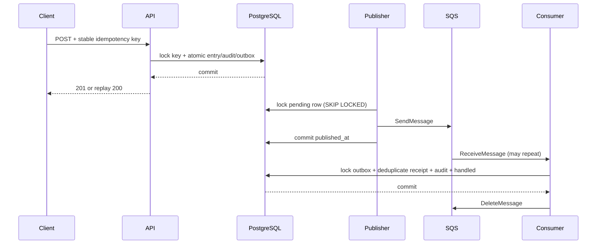

# v2 architecture and control design

## Scope and architectural decision

Use a modular single service rather than unnecessary microservices. Separate API and asynchronous workloads only where scaling, failure isolation and privileges differ. The deployment target is one AWS region with two AZs, private compute, isolated database subnets and private Kubernetes API by default. The local path remains SQLite for repeatable evaluation; cloud uses PostgreSQL 16. This is not a live installation.

| Workload | DB permissions | AWS permissions |
|---|---|---|
| API | select all journal/control tables, insert entries/audit/outbox; no update/delete | read own DSN secret |
| Publisher | read outbox, update publication/quarantine fields | read own secret; send to events queue |
| Consumer | read outbox/receipts, insert receipt/audit, set handled timestamp | read own secret; receive/delete events |
| Archive | read audit/receipt, insert archive receipt | read own secret; put/get audit objects only |
| Migrator | schema owner, DDL, grant roles | read own DSN secret; run via reviewed migration job |

The RDS master is bootstrap/administrative only, not a workload credential. PostgreSQL connects with `verify-full` against a trusted RDS CA. DSNs live in Secrets Manager and are fetched by each pod via EKS Pod Identity; no database password in Terraform state or Git. DSN retrieval occurs at startup; credential rotation requires a controlled restart or coordinated rollout. Node IAM is not used by application code; IMDSv2 hop limit 1 restricts ordinary pod metadata access. CNI network policy is ingress-only; egress isolation remains a site-specific approval gate. OIDC issuer and JWKS are explicitly configured over HTTPS; RS256, issuer, audience, expiration, issued-at and subject are checked; scopes map to internal roles. The audit actor is a pseudonymous issuer+subject hash, not a verified real name. No multi-tenant access boundaries.

## Recording and reversals

1. Authenticate scope and validate bounded JSON plus idempotency header.
2. Lock the idempotency key within the DB transaction: SQLite `BEGIN IMMEDIATE`; PG transaction-scoped advisory lock on stable key hash. Compare the canonical request digest for existing keys.
3. For a reversal, also lock the original ID; reject a second reversal, a reversal of a reversal, a mismatched amount/loan/currency or earlier effective date. Full original amount is derived from the DB. DB trigger and unique partial index reinforce this invariant.
4. Insert immutable entry, audit event and outbox event atomically; commit before returning success. Positive amount is recorded for both types; `reversal_of` determines sign for net journal totals.
5. The write transaction is independent of queue and archive availability. Operator reconciliation exposes outstanding work.

## Delivery and failure semantics

SQS is standard, at least once and potentially out of order. Do not claim exactly-once delivery. Publisher uses a bounded SDK call under one DB row lock; if send succeeds and DB commit fails, retry can publish twice. Consumer validates envelope against persisted canonical outbox payload, commits before acknowledgement and writes a unique `(consumer_name,event_id)` receipt plus audit marker. Its business side effect is only the internal receipt. It is not an arbitrary external payment/transfer side effect. Malformed messages remain unacknowledged for redrive to DLQ. Quarantined stored events need incident investigation. Queue retention is finite; monitor unhandled published rows and requeue only following approval. No ordering dependency exists between original and reversal receipts: net amount is computed from committed entries, not the queue. RDS failover can interrupt DB operations; client retries must reuse key.

## Archive and recovery

Audit/entry rows reject updates/deletes; database owners retain administrative power. Archive job serializes exports, conditionally puts one object per audit ID, stores checksum, and marks receipt after put. An ambiguous failure re-reads existing bytes; mismatch stops export. Object Lock COMPLIANCE default retention protects versions for the configured period after successful export; archive lag is a residual exposure and backup/restore does not establish audit completeness. The retention period is illustrative, not regulatory policy. RDS automated backups and Multi-AZ support recovery; neither provides demonstrated RTO/RPO until drills are executed. The supplied restore fingerprint checks all journal tables for quiesced disposable DBs.

## Capacity and observability

API metrics use bounded route/method/status labels; reconciliation metrics have fixed kind labels. Grafana and Prometheus alert definitions use max across replicas for shared DB counts and rate aggregation for HTTP metrics. OTLP HTTP request spans omit raw paths, identifiers and payloads; full distributed propagation and worker tracing are future work. CloudWatch alarms cover queue age, visible DLQ and DB CPU. The API currently opens a short-lived DB connection per operation; load-test production traffic, size PostgreSQL connections, add a bounded pool or RDS Proxy if justified. Worker SDK and DB statement timeouts are bounded; publishers currently process one row at a time to simplify failure handling. Proposed targets: 99.9% service availability, p95 under 500 ms for agreed workload, backlog age under 120s, 15-minute RPO and 60-minute RTO; none is a demonstrated production SLO.

## Sources used for technical reference

- [Amazon SQS standard queues](https://docs.aws.amazon.com/AWSSimpleQueueService/latest/SQSDeveloperGuide/standard-queues.html)
- [Amazon SQS visibility timeout](https://docs.aws.amazon.com/AWSSimpleQueueService/latest/SQSDeveloperGuide/sqs-visibility-timeout.html)
- [EKS Pod Identity](https://docs.aws.amazon.com/eks/latest/userguide/pod-id-association.html)
- [EKS network policy configuration](https://docs.aws.amazon.com/eks/latest/userguide/cni-network-policy-configure.html)
- [Terraform AWS EKS cluster](https://registry.terraform.io/providers/hashicorp/aws/latest/docs/resources/eks_cluster)
- [GitHub AWS OIDC](https://docs.github.com/en/actions/how-tos/secure-your-work/security-harden-deployments/oidc-in-aws)
- [Sigstore signature verification](https://docs.sigstore.dev/cosign/verifying/verify/)
