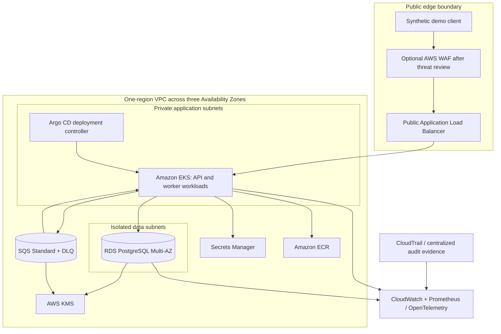
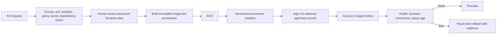
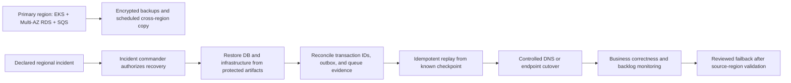
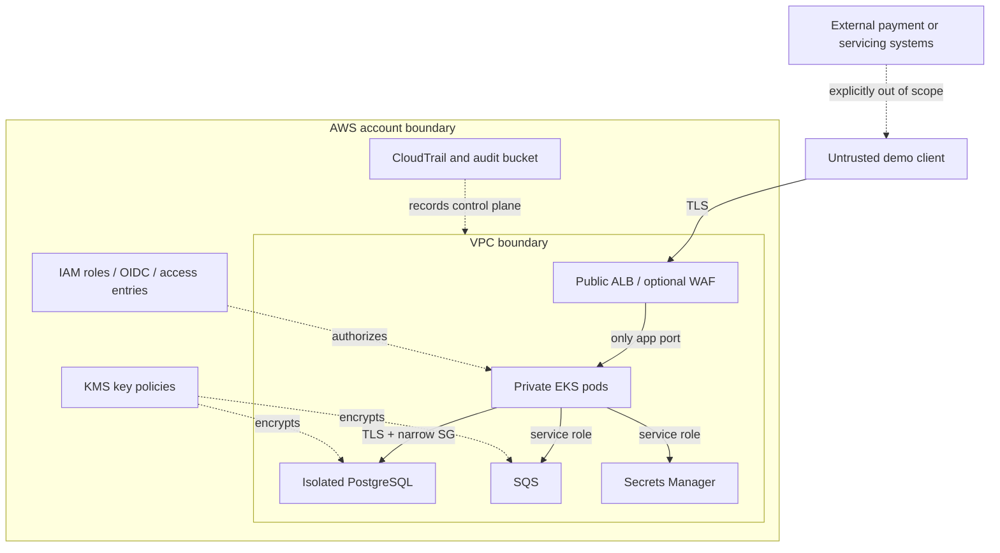

# Architecture and business case

## Executive assessment and selected project

**Servicing Ledger Platform** is an independent, synthetic loan-servicing transaction-recording platform. It accepts a servicing entry, persists a unique operation and audit record atomically, and publishes a versioned event through an outbox to an idempotent consumer.

| Item | Decision |
|---|---|
| Industry segment | Mortgage lending and loan servicing |
| Primary capability | Reliable recording and downstream processing of synthetic servicing entries |
| Business stakeholders | Servicing operations, risk/control owners, technology leadership |
| Technical stakeholders | Platform, application, database, security, SRE, and audit teams |
| Target users | Internal servicing application and operations engineers; synthetic demo client |
| Primary workflow | Accept request → validate → record entry, idempotency key, audit event, and outbox row atomically → asynchronously consume and reconcile |
| Pain point represented | Retries, partial failures, and fragmented evidence can create duplicate or ambiguous servicing outcomes |
| Business risks | Duplicate effect, missing event, untraceable correction, backlog growth, or unclear recovery state |

The choice fits the supplied candidate profile: it extends the stated mortgage/loan-servicing infrastructure experience, managed database work, recovery automation, and auditable delivery without claiming those professional accomplishments as outcomes of this portfolio project. It is achievable by one engineer because the core workflow is intentionally narrow and external rails are simulated. Senior-to-Staff signals come from explicit correctness guarantees, failure-domain decisions, cost controls, change governance, and honest evidence boundaries rather than service count.

### Scope boundaries

**In scope:** one synthetic servicing entry; request idempotency; relational consistency; audit and outbox records; duplicate event handling; reconciliation hooks; secure platform design; deployment, SRE, recovery, and cost practices.

**Out of scope:** initiating or settling payments, loan origination, calculating interest or balances, credit decisions, fraud detection, customer identity, real customer records, card data, bank-account details, external lender APIs, production credentials, and claims of regulatory certification.

Legacy approaches the design is meant to improve on include manually provisioned environments, inconsistent change paths, direct database edits, publishing events outside the database transaction, limited transaction-level telemetry, and recovery procedures without regular evidence. Expected value is a design objective until a reproducible experiment measures it.

## Assumptions and requirement priority

These are design assumptions, not observed business volumes or measured performance.

| Dimension | Portfolio assumption | Enterprise reference assumption / reason |
|---|---|---|
| Actors | Demo client, API, outbox publisher, consumer, operator | Internal servicing channel plus controlled downstream services |
| Workload | 1 request/s typical, 20/s short burst; synthetic only | Capacity is workload-specific and must be benchmarked |
| Latency | Proposed p95 API objective < 500 ms after validation | End-to-end business latency depends on dependencies and queue age |
| Availability | Proposed 99.5% monthly API objective | Not a contractual target; measure by accepted requests |
| Deployment | One engineer, several reviewed changes per week | Small platform team owns shared modules and golden paths |
| Data retention | Local demo DB disposable; cloud audit/transaction retention set by policy before deployment | Retention and deletion must reflect legal, records, and privacy review |
| Consistency | Acknowledged entry, idempotency record, audit row, and outbox row commit together | Relational source of truth; downstream projections are eventually consistent |
| Peak behavior | Reject oversized payloads; queue absorbs downstream slowness | Alert on oldest-message age and backlog, not only queue depth |
| Recovery | Portfolio restore objective: 8h RTO / 24h RPO for region loss | Targets only; enterprise reference may require warm standby and measured tighter objectives |
| Budget | Local by default; cloud environment time-limited | AWS Pricing Calculator estimate required before each deployment |

| Priority | Requirements |
|---|---|
| **Mandatory** | Stable idempotency key; atomic state/audit/outbox write; duplicate-safe consumer; synthetic-only data; encryption and least privilege in AWS; reviewed plans; immutable audit design; cost gates; repeatable recovery procedure |
| **Important** | Multi-AZ EKS and RDS, queue/DLQ alarms, service ownership metadata, policy scanning, progressive delivery, OpenTelemetry correlation, backup restoration exercise |
| **Stretch** | Second-region warm standby, cell isolation, Backstage, service mesh, automated evidence packaging, AI incident assistant connected to approved telemetry |

Security, privacy, recoverability, correctness, maintainability, and cost controls are mandatory. Scale and advanced developer-portal features follow only after the core workflow is proven.

## AWS reference architecture



The diagram is the enterprise-oriented reference. The portfolio minimum is a short-lived, single-region environment; the current repository's runnable implementation is local only. Enterprise accounts, central security/logging accounts, Organizations policies, and cross-account networking are documented options, not deployed resources.

### Component responsibilities and trade-offs

| Component | Requirement / responsibility | Failure and operations | Cost / alternative |
|---|---|---|---|
| EKS | Standard runtime and platform patterns for API/consumer | Cluster upgrades, add-ons, node capacity, policy enforcement | Control plane and nodes run continuously; ECS is cheaper/simpler for this single API |
| RDS PostgreSQL Multi-AZ | Atomic servicing record, idempotency, audit, outbox | Failover can pause writes; monitor connection recovery and backups | Higher than single-AZ; single-AZ is acceptable only for disposable demos |
| SQS Standard + DLQ | Buffer and retry asynchronous work | At-least-once delivery; DLQ needs redrive and investigation process | FIFO only if measured ordering requirement justifies constraints/cost |
| S3 | Terraform state, controlled artifacts, evidence exports | Misconfiguration or deletion can block operations | Encryption, versioning, retention, and tight access required |
| KMS / Secrets Manager | Encryption and runtime secrets | Key policy or secret outage can block service; rotation needs rehearsal | Use managed services before self-hosting Vault |
| CloudTrail / CloudWatch | AWS API and platform evidence, alarms | Retention and costs grow; avoid sensitive payload logging | Keep structured logs minimal; centralize only when justified |
| Prometheus / Grafana / OTel | Service and business-process telemetry | Cardinality and collector failure; use bounded labels | Begin with CloudWatch or local Prometheus; managed service costs can dominate |
| GitHub Actions + Argo CD | Validate changes, promote desired state, reconcile deploys | Pipeline or controller outage pauses delivery, not transaction processing | CI owns validation/image creation; Argo owns in-cluster sync |

### Transaction and event flow

AWS Config, GuardDuty, Security Hub, and Inspector are considered for an advanced isolated account after cost and coverage review. Enable them with a finding owner, retention policy, suppression process, and evidence requirement; do not turn them on as an unowned checklist. CloudTrail should deliver to a restricted, encrypted evidence bucket in an enterprise logging account.

```mermaid
sequenceDiagram
  participant C as Synthetic caller
  participant A as Servicing API
  participant D as PostgreSQL
  participant O as Outbox publisher
  participant Q as SQS Standard
  participant W as Idempotent worker
  C->>A: Request + Idempotency-Key
  A->>A: Validate synthetic payload and hash canonical request
  A->>D: Begin; reserve key; write entry + audit + outbox
  D-->>A: Commit
  A-->>C: 201 with entry ID and RECORDED state
  O->>D: Read pending outbox row
  O->>Q: Send event ID and versioned payload
  O->>D: Mark sent after broker acknowledgement
  Q->>W: At-least-once delivery
  W->>D: Insert unique consumer receipt + projection in one DB transaction
  W-->>Q: Delete only after durable commit
```

Success returns only after the durable transaction commits. A repeated HTTP request with the same key and same canonical body returns the stored result; a changed body with the same key is a conflict. A publisher crash after SQS accepts a message but before the outbox row is marked sent may publish a duplicate. The consumer's unique `(consumer_name, event_id)` receipt and business-effect transaction make replay safe. A persistent poison event moves to a DLQ and requires an operator-led, audited replay or correction. Partial outcomes are surfaced as `RECORDED` plus delivery state, never described as settled.

Corrections in the reference domain are append-only: an authorized correction or reversal record references the original entry, carries its own idempotency key and reason code, and is guarded by an expected record version. It never edits or deletes the original event. The starter app does not yet implement correction endpoints. The selected workflow does not require strict event ordering between independent entries; if multiple state-changing events for one aggregate are introduced, add an aggregate sequence/version and choose a FIFO/grouping strategy only after validating throughput and recovery behavior.

### Delivery architecture

Planned CI checks: Terraform format/validate and plan scan (Checkov or equivalent), secret scanning, dependency review/software composition analysis, image scanning (Trivy or equivalent), SBOM and build provenance, manifest/Helm validation, and policy-as-code. Pin CI actions by immutable reference in an implementation. No workflow is wired up in this scaffold.



Use GitHub Actions OIDC for short-lived role sessions; separate plan from apply roles and require human approval for apply. Pin actions by immutable reference in the implementation. Argo CD reconciles only the approved Git revision. Production-equivalent promotion and rollback are documented but not wired up yet.

### Recovery architecture



Portfolio strategy is backup-and-restore. Enterprise reference may add warm standby if business-approved objectives justify continuous cost. A Multi-AZ RDS deployment protects against an AZ or DB instance event within a region; it does not by itself recover from a regional outage. Cross-region replication and restored state can lag, so uncertain requests must be reconciled by stable entry/event ID before replay.

### Trust and failure boundaries



The client, AWS account, VPC, Kubernetes namespace, workload identity, database, broker, and external systems are separate trust boundaries. EKS pods receive only their service role. The DB accepts traffic only from the API/worker security group. Logs and traces omit identifiers that could reveal a customer; only synthetic IDs are used here.

## Network and EKS decisions

Account topology for the portfolio is one dedicated development account with no production data. The enterprise reference separates development, shared services, security, logging, and production-equivalent accounts under organization guardrails, with centralized audit evidence and controlled cross-account roles. No hybrid network is assumed. Any cross-region connection uses explicit routes and identity policy rather than broad peering.

Additional EKS guardrails: define priority classes only if competing workloads need them; pull approved immutable image digests from ECR; verify provenance at admission; keep automatic service-account token mounting disabled when the pod does not need Kubernetes API access. Use the AWS Load Balancer Controller only for an explicit ingress requirement. The implementation will validate that the selected CNI enforces NetworkPolicy before relying on policy objects.

| Option | Strength | Cost / burden | Decision |
|---|---|---|---|
| One isolated VPC, private application subnets, isolated database subnets, one NAT for a short-lived lab, tightly allowlisted EKS API | Simple to understand and reproduce | One NAT is an AZ dependency and can cause cross-AZ egress; private endpoints add hourly charges | Portfolio, only during a controlled window; deploy two AZs minimum, three for reference |
| Per-AZ NAT plus selected gateway/interface endpoints | Better AZ independence and predictable service egress | More NAT and endpoint cost | Preferred higher-availability reference when budget allows |
| Central egress VPC + Transit Gateway + multi-account landing zone | Shared policy and network inspection | Operational complexity and steady charges inappropriate for one engineer's MVP | Enterprise reference only |

Suggested address plan: VPC `10.60.0.0/16`; reserve separate `/20` ranges per AZ for public ingress, private application, and isolated data tiers. Validate all CIDRs against organization/VPN ranges before apply. Use Route 53 private DNS for internal dependencies, TLS at the ALB, and TLS from workloads to managed services. Security groups express service paths; NACLs remain broad subnet guardrails only. Kubernetes NetworkPolicy further restricts pod traffic where the chosen CNI enforces it. No public database address, unrestricted node SSH, or `0.0.0.0/0` cluster API allowlist.

EKS reference: managed control plane across AZs; managed node groups for stable system capacity; consider Karpenter only after baseline demand is known; HPA for API/consumer replicas; topology spread and PodDisruptionBudgets; resource requests/limits; restricted pod security; EKS Pod Identity or IRSA; Helm packages; Argo CD ApplicationSet for environment promotion. Avoid running Cluster Autoscaler and Karpenter together without a defined ownership boundary. Avoid a service mesh until mTLS or traffic-shaping requirements are measured. Cluster upgrades, add-on compatibility, image-pull policy, admission checks, and backup restoration belong in release runbooks.

EKS versus ECS: this project selects EKS because the candidate profile includes Kubernetes and internal platforms, and the project demonstrates reusable platform capability. For a single small service, ECS would reduce control-plane, upgrade, add-on, and policy burden. The project must explicitly defend that trade-off in an interview.

## Internal Developer Platform, Terraform, and ownership

The first golden path is a template repository with a service manifest, typed Helm values, health/readiness probes, resource defaults, security context, owner metadata, CI workflow, and runbook. Approved Terraform modules and an environment request PR provide self-service without direct unreviewed AWS provisioning. A catalog or Backstage is deferred until there are multiple services and owners; a repository template is enough for this project.

Platform guardrails are enforced in CI and IAM: module allowlists, static policy checks, protected branches, no long-lived credentials, reviewed plans, image scanning/signing, namespace quotas, and service-account identity. Overrides require a documented exception and human approval. Platform acceptance is measured by template reproducibility, guardrail outcomes, and time-to-first-local-deploy measured in a later experiment—not assumed productivity gains.

Terraform owns AWS resources; Helm/Argo CD own in-cluster desired state; application repositories own business code and schema migrations. They do not both manage the same resource. State design, locking, module versioning, drift response, imports, break-glass, and approval workflow are described in [Terraform implementation boundary](../infra/terraform/portfolio/README.md).

